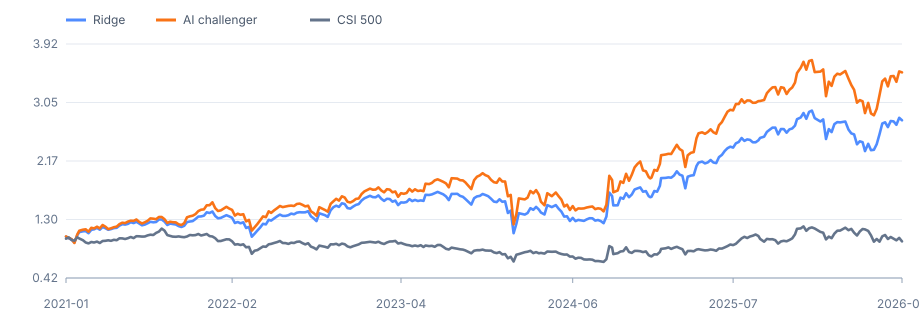
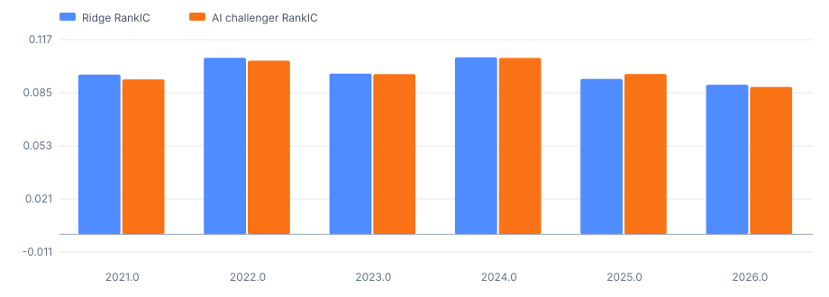
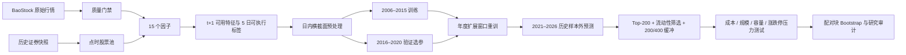

# A 股点时多因子与机器学习研究

[](https://github.com/yuhaoyan04/ai-quant-research/actions/workflows/tests.yml)

这是一个从原始行情、点时股票池到可执行组合和统计审计的完整 A 股量化研究项目。研究对象是周频横截面选股：在每个决策日只使用当时可获得的信息排序股票，下一交易日收盘执行，随后持有 5 个交易日。

项目的目标不是寻找最好看的回测曲线，而是回答三个可检验的问题：传统因子是否在严格时序下仍有预测力、非线性模型是否提供可泛化增量、收益能否经受成本与成交约束。

## 结论先行

| 最终日频可成交口径（2021–2026，20bp） | Ridge | HGB |
|---|---:|---:|
| raw 年化收益 | **17.80%** | **20.81%** |
| raw Sharpe（R0: rf=0）/ 最大回撤 | 0.86 / -32.99% | 0.94 / -33.32% |
| industry+size neutral 年化收益 | 15.87% | 20.26% |
| CSI500 + 六风格后的残余 Alpha | -1.74% | +1.05% |

| 可成交 Incremental Alpha Test | ML 年化 | 风格复制年化 | 年化算术增量 95% CI | 四策略 BH-FDR |
|---|---:|---:|---:|---:|
| HGB industry+size neutral | 20.26% | 15.96% | **[0.23%, 7.28%]** | 未通过（q=7.20%） |
| HGB raw | 20.81% | 17.58% | [-0.44%, 6.47%] | 未通过 |
| Ridge industry+size neutral | 15.87% | 13.45% | [-1.57%, 5.80%] | 未通过 |
| Ridge raw | 17.80% | 16.09% | [-1.97%, 5.25%] | 未通过 |

- 最终结果使用 1,387 个唯一日频净值日、股数订单、停牌/涨跌停逐日重试和 20bp 线性成本；它比早期周频标签组合更接近可执行口径。
- 统一模型基准的 HGB historical OOS RankIC 为 0.0999、Ridge 为 0.0976；HGB 二维验证面仅为 0.0971–0.0998，但年度最优参数不稳定，不能泛化为“机器学习稳定胜出”。
- PIT 行业+规模中性化后，15 个单因子中没有定向 RankIC 显著增强；四个动量因子显著减弱，其余 11 个差异不显著，说明部分动量预测力依赖行业/规模结构，但多数信号没有被完全解释。
- 完整单因子 tear sheet 已覆盖十分位单调性、Top–Bottom、换手、年度与市场状态。行业+规模中性化后，14/15 个因子的毛 Top–Bottom 价差通过 BH-FDR 5%，仅 `earnings_yield` 未通过；但 `down_high` 状态下多个因子失效，且分位组合未建模借券和完整成交，不能当作可交易多空业绩。
- 修复两期被静默截断的证券快照后，锁定模型实验显示：行业+规模中性化使 Ridge RankIC 从 0.0986 降至 0.0900、年化收益从 21.24% 降至 15.54%；HGB RankIC 从 0.1006 降至 0.0941，收益差异区间跨零。两者的 Top-200 行业主动权重都没有自动下降，证明因子正交不等于组合行业中性。
- 显式组合优化已完成：单股≤0.5%、行业主动权重逐行业≤±3%、|size-z|≤0.10、周换手目标≤30%。原始 HGB 组合约束后年化 24.68%、波动 28.13%、Sharpe 0.92、最大回撤 -32.90%，全部 293 周无换手约束放宽；收益仍是理想完整成交、20bp 研究口径。
- 约束组合已接入非重叠日频成交引擎。原始 HGB 在同口径下从理想全成交年化 22.18% 降至停牌/涨跌停逐日重试后的 20.81%，Sharpe 0.94、最大回撤 -33.32%；年化算术成交折损 95% 区间为 [-1.66%, -0.68%]。
- Phase 5 将冻结的 raw HGB 目标接入人民币股数、订单状态、T+1、整手、10% 日成交量参与率、公司行动代理和逐日现金/持仓/NAV 账本。受限场景年化 20.66%、Sharpe 0.93、最大回撤 -33.31%，移除停牌/涨跌停/成交量约束的上界为 22.08%；成交股数比例 98.83%，平均目标偏离 L1 为 2.31%。这是已查看 historical OOS 的日线近似诊断，不是真实券商成交或新独立证据。
- Phase 6 在同一 raw HGB 分数、日期、20bp 成本和账户执行器下比较 Top-200/400 缓冲等权、逆波动率、分数加权与严格约束优化。P0/P1/P2/P4 年化分别为 22.14%/21.77%/19.56%/18.81%；P1 相对 P0 的收益差区间跨零，P2 区间完全低于零。P4 把波动和回撤降到 21.63%/-32.26%，但严格 LP 仅 45.4% 日期可行、成交股数比例仅 58.8%，因此保留 P0，不晋升复杂方法。P4 可行性处理属于已披露的 post-OOS adaptation。
- Phase 7 将冻结主账户的目标权重、实际股数、实际权重、现金、订单、成交、费用与公司行动统一为逐日账本。1,387 个账户日全部通过现金/NAV/持仓独立回放，股数迁移误差为 0、T+1 违规为 0；旧公司行动表缺少场景键的问题被保留并显式警告，新账本按账户重建 1,034 条行动记录。
- Phase 8 保存 18,499 条配对原序列，统一报告 HAC 与多组 circular-block 长度，并把 37 个假设拆为四个独立 BH-FDR 检验族。raw HGB 相对风格复制基准的年化增量为 2.87%，20 日块区间 `[-0.44%, 6.47%]`、族内 q≈0.103，仍不能声称显著纯 Alpha；172 项主要尝试已进入 trial registry，避免选择性报告。
- Phase 9 把绝对收益、CAPM、CSI500+六风格归因、可交易风格复制增量和风险调整增量统一到同一 1,387 日证据矩阵，并把4条ML与4条风格复制路径全部接入1亿元股数级订单账本。八条按股数成交率为75.62%–99.49%，0次T+1违规，现金/NAV全部对账；四条风险调整增量 Alpha 为 -0.44% 至 +1.22%，区间均跨零、四候选 BH-FDR 0/4。Phase 9实现范围已完成，但仍不能声称识别纯个股 Alpha。
- Phase 10 将Phase 5/6/9重复的未复权行情、公司行动代理和涨跌停执行市场逻辑收敛为单一实现；三类板块真实数据逐行回归误差为0。工程协议覆盖显式随机seed、五层测试、关键输出experiment ID、不可变快照和开放缺口登记，当前无P0工程缺口。
- Phase 11 已冻结 `hgb_shallow15_locked/raw/P4_constrained` 前向模型包（318,300条训练样本、1,061个周频截面、模型 SHA-256 固定），并建立只允许真实日期增量运行的 paper-trading 管线。每次运行保存 PIT 输入、信号、目标、订单、成交、现金、持仓、NAV、依赖哈希和不可变运行目录；失败日同样进入 SHA-256 链。激活日为 2026-10-21，当前只有 1 次 `NOT_ACTIVE` 运营记录、0 个成功前瞻观测，因此仍不构成前瞻业绩证据。
- Phase 11.1 新增 `quant-forward-data` 前瞻数据供应链：所有可变数据进入独立`forward_*`命名空间，自然键增量更新日历、已完成周证券快照、月度行业快照和活跃股票行情，只对变更证券重算质量、因子与标签；历史研究表固定在2026-09-30并保持冻结SHA。paper runner读取逐证券PIT截面，并用前瞻交易日历阻止周中提前调仓。该工程补丁不改变冻结模型、P4约束或20bp成本，也不产生新的业绩结论。
- Phase 1 已将买入、卖出、双边成交额和单边换手统一到 fill 级协议；C0 20bp 严格复现 20.81%，同一成交路径下 raw HGB 的 100bp 年化为 6.20%。含日期生效印花税/过户费和 3bp 双边佣金假设的 C2 情景为 22.11%，但它不是历史券商账单；详见[交易成本报告](reports/transaction_cost_model.md)。
- Phase 2 新增中央结算公司中债国债收益率曲线数据产品：3个月主基线与1年敏感性均覆盖1,387日、0缺失、0插值，并按“观察日次日可用 + ACT/365复利”对齐。3个月利率下 raw HGB Sharpe 从0.937降至0.863；其CSI500 CAPM Alpha为17.55%，95%区间[3.63%, 31.46%]，但六风格残余Alpha仅0.86%，区间跨零。详见[无风险利率与归因报告](reports/risk_free_rate_attribution.md)。
- 市场基准现同时支持价格指数和中证官方全收益指数。CSI500 全收益/价格指数年化分别为4.10%/2.32%，同源几何股息再投资楔子约1.74%；在3个月国债rf下，raw HGB相对CSI500全收益指数的CAPM Alpha降至16.19%，六风格残余Alpha降至-0.65%，后者仍不显著。详见[价格与全收益基准报告](reports/market_benchmark_attribution.md)。
- PIT 多因子归因显示行业主动贡献接近零，但 raw HGB 的年化算术风格贡献约 13.61%，主要来自流动性、波动和动量；特异选股贡献约 -0.43%，95% 区间 [-3.52%, 3.08%] 跨零。当前证据支持“受控风格溢价”，不支持“稳定纯个股 alpha”。
- 第一版风险感知政策（有效冻结登记 `risk_aware_portfolio_optimization_v2`）将 raw HGB 的预测跟踪误差从 8.07% 降至 4.43%，但年化收益降至 18.69%，配对收益差 95% 区间完全低于零；20% 目标波动层也没有改善 Sharpe。该政策被明确登记为失败实验，不替换原约束组合。
- 非重叠日频 CAPM 的旧零利率价格指数对照为13.60%–17.92%。同时改用3个月中债国债曲线和中证官方CSI500全收益指数后，四条年化算术 Jensen Alpha 为11.87%–16.19%；HGB两组与Ridge raw的95%区间下界高于0，Ridge neutral跨零。加入六风格后四条Alpha均跨零，因此不能把单因子截距解释为纯个股 Alpha。
- 加入六个 PIT 自融资风格组合后，四条可成交组合的年化残余 Alpha 降至 -2.55%–+1.07%，95%区间全部跨零，R²约0.895。回归不存在明显多重共线性；CAPM 截距主要由小盘、非流动性和反转等风格吸收，当前不支持显著纯选股 Alpha。
- Incremental Alpha Test 为每条 ML 组合构造同行业内、规模与六风格匹配的 PIT 同业复制组合，并共享 30% 周换手上限、停牌/涨跌停逐日重试和 20bp 成本。HGB neutral 的单项增量区间排除零，但四条策略 BH-FDR 后 0/4 通过；Ridge raw 只有换手改善通过相应检验族。结论是“局部选股/实施价值”，不是跨模型稳定纯 Alpha。
- 2021–2026 的结果已在研发过程中被检查过，应称为历史样本外证据，不是从未查看的生产 lockbox，也不是实盘业绩。





求职版交付见 [最终研究报告](reports/final_research_report.md)、[PDF](reports/final_report.pdf)、[一页摘要](reports/executive_summary.md)、[简历表述](docs/resume_bullets.md) 与 [面试讲稿](docs/interview_guide.md)。审计与复现入口为 [结论与全链路审计](reports/research_conclusion_audit.md)、[自动产物审计](reports/research_audit.md)、[离线交互面板](reports/research_dashboard.html) 和 [跨机器复现指南](docs/reproduction.md)。专项实验仍保留在 `docs/`、`reports/` 与不可变实验目录中。

完整数据湖不上传 GitHub；跨机器接力时从 BaoStock 下载主数据，并用 AKShare 做独立抽样核对。
环境安装、断点续传、数据血缘、验收门禁和一键全流水线见[跨机器复现指南](docs/reproduction.md)。

## 研究流程



关键设计：

- 数据：BaoStock 为股票主源；AKShare 用于股票抽样核对及官方中债接口适配，市场归因另保存中证指数公司官方价格/全收益序列，任何来源都不静默覆盖另一来源。
- 股票池：使用历史 `query_all_stock(day)` 快照并延迟至下一交易日生效，避免幸存者偏差；它不是官方历史中证成分。
- 标签：信号日为 `t`，特征在 `t+1` 可用并按 `t+1` 收盘执行，收益覆盖 `t+2` 至 `t+6`。
- 切分：2006–2015 训练、2016–2020 验证、2021–2026 历史样本外；边界按标签跨度 purge。
- 模型：正则化 Ridge 基线与 HistGradientBoosting challenger；模型和组合参数只在验证期选择。
- 组合：Top-200 等权，剔除流动性两端最弱部分，使用 200/400 排名缓冲降低边界换手。
- 推断：所有模型比较使用共同日期，并以 13 周循环块 bootstrap 保留短期序列相关。

## 数据规模与研究产物

- 2006-01-04 至 2026-09-30；5,521 只历史 A 股。
- 1,059 个周度点时证券快照，约 1,479 万行模型特征。
- 15 个量价、流动性、估值与反转/动量因子。
- 250 个历史证监会行业快照；PIT 周度行业暴露最低年度覆盖率 98.55%。
- 训练、验证、年度扩展窗口样本外预测，以及持仓级结果。
- 成本、换手、流动性、规模、ADV 容量、市场冲击和 t+1 涨跌停/停牌压力测试。
- 211 个单元/集成/回归测试；当前自动产物审计为 496 PASS / 46 WARN / 0 FAIL。

## 快速验证已提交结果

普通 Git 不提交体积很大的原始/中间 Parquet。仓库保存可审计的代码、配置、测试、冻结实验快照
和展示结果；新机器按[跨机器复现指南](docs/reproduction.md)从免费源重建数据湖后，可执行：

```powershell
conda create -n ai-quant python=3.11 -y
conda activate ai-quant
pip install -e ".[dev]"

python -m pytest -q
quant-research-dashboard
quant-audit
quant-rf-hyperparameter-stability
quant-hgb-hyperparameter-stability
quant-model-stability-validation
quant-research-governance status
quant-portfolio-sensitivity
quant-portfolio-construction-comparison all
quant-unified-account-ledger run
quant-statistical-inference run
quant-alpha-evidence run
quant-incremental-alpha-fill all
quant-engineering-quality run
quant-paper-trading status
quant-transaction-costs run
quant-risk-free-attribution
quant-market-benchmark-attribution
quant-incremental-alpha all
quant-conclusion-audit
quant-final-report
```

`quant-audit` 会检查预测键唯一性、信息可用日期、验证集选参来源、组合收益恒等式、持仓权重、共同比较日期、年度 RankIC 和 bootstrap 结论；任何硬失败都会返回非零退出码。

### 冻结实验与可复现性

当前 52 个实验版本已登记为不可覆盖快照。每个快照包含解析后的配置、指标表、图表、环境版本、代码树哈希、输入数据 SHA-256 与 historical OOS 使用声明；失败与被替代实验同样保留。Phase 3 保留 expanding/10 年 rolling、逐年失败标记、RF 多 seed 分布和非因果 Purged CV 补充诊断；Phase 4 将 2021–2026 标记为已消耗历史证据，Phase 11 进一步冻结 forward-only paper-trading 执行协议、生产模型包和 hash-chained 运行日志。

```powershell
# 查看已登记实验
quant-experiment list

# 同时校验快照自身与当前数据湖输入
quant-experiment verify baseline_ridge_v1
quant-experiment verify challenger_hgb_blend_v1
```

实验索引见 [reports/experiments/index.json](reports/experiments/index.json)，注册规则见 [config/frozen_baselines.yaml](config/frozen_baselines.yaml)。若重建上游表改变了内容，即使文件名不变，哈希门禁也会报告失败。

## 从原始数据复现

先在**单独的临时 checkout** 运行小样本，验证网络、schema、Parquet 和断点续传；不要把
`--limit 5` 生成的短历史文件留在随后用于全量重建的正式目录：

```powershell
quant-free-lake bootstrap --start 2024-01-01 --limit 5
quant-free-lake crosscheck --start 2024-01-01
```

再构建完整数据并依次运行研究层。完整下载耗时较长，每只证券独立落盘并写 manifest，可在相同
日期范围内中断续跑。推荐使用脚本，它还包含本文未展开的全部后续实验：

```powershell
powershell -ExecutionPolicy Bypass -File scripts/rebuild_all.ps1 `
  -StartDate 2006-01-01 -EndDate 2026-09-30 -IsolateBars
```

更细的字段、公式和逐步解释见 [端到端教程](docs/end_to_end_tutorial.md)、[因子目录](docs/factor_catalog.md) 和 [数据手册](docs/data_handbook.md)。

## 不能忽略的边界

1. 已完成月度历史证监会宽行业的 PIT 因子中性化、组合主动权重约束及六风格风险归因，但它不等同于申万细分行业或商业风险模型。
2. 股票池是历史 A 股代理，不是官方 CSI 100/500/1000 历史成分。
3. 旧价格指数口径保留，同时新增含税前现金红利再投资的中证官方全收益指数；个股 `pct_chg` 仍不是独立复权总收益序列，策略也未建模真实撮合队列和基金申赎。
4. 平方根冲击模型尚未用券商订单校准，容量结果是情景分析而非资金承诺。
5. Paper-trading 管线已经冻结并留有一次激活前运营记录，但成功前瞻观测仍为 0；所有收益数字仍来自历史研究回测，不是 paper/live 业绩。

这些限制不是脚注，而是结论的一部分。项目当前最有价值的成果，是一条时间口径一致、可审计、能够明确区分“正向证据”和“尚不显著增量”的研究链路。
