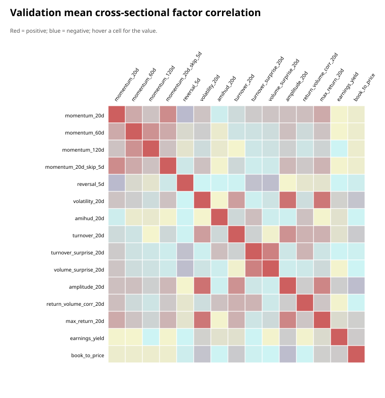
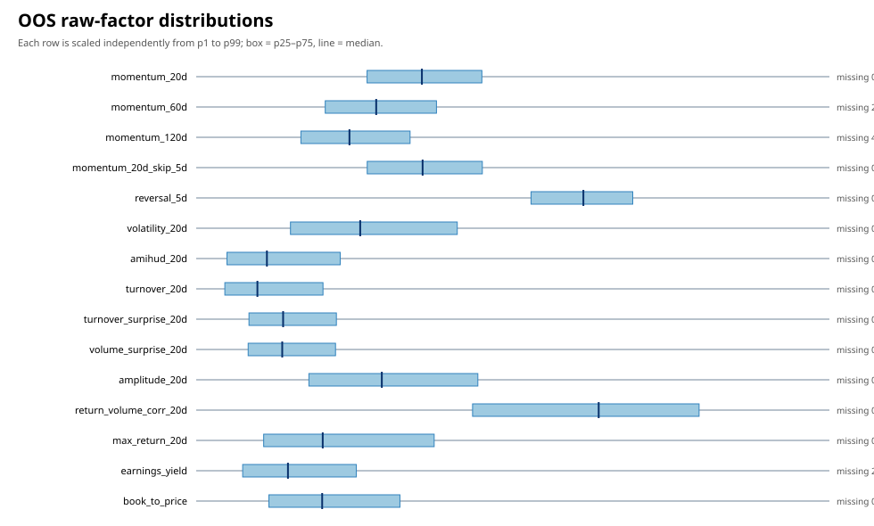

# A 股横截面多因子选股：点时数据、风险中性化与可成交归因

**研究期间：** 2006-01-04 至 2026-09-30

**训练 / 验证 / historical OOS：** 2006–2015 / 2016–2020 / 2021–2026

**最终研究状态：** 代码、配置、测试、数据血缘、失败实验和 43 个不可变实验版本已纳入统一治理。

Phase 3 已冻结并完成模型稳定性验证：naive、Ridge、ElasticNet、Random Forest 与 HGB 在共同日期、共同标签和 20 bps 往返成本下进行 expanding/10 年 rolling walk-forward；RF 报告三个预设 seed 的均值、标准差和范围；五个验证年份执行标签区间 purge 的补充 CV。rolling 在验证期改善部分净收益，但在 historical OOS 上 ElasticNet/HGB 的配对差异显著转负，因此不根据已查看的 OOS 切换窗口或晋升模型。

Phase 4 已把 2021–2026-09-30 明确登记为 consumed historical OOS，并冻结 `candidate_bundle_v1`、未来假设族、成本执行规则和开箱门槛。`future_lockbox_2026q4_2027q3_v1` 在 2027-09-30、252 个日频观测、52 个周频信号、12 个月和 95% 覆盖率同时满足前保持绩效封存；paper trading 只允许候选提交后的真实时间记录，禁止回填。当前两类未来证据均为空，因此 `ready_for_live_capital` 仍为 NO。

Phase 5 没有重训模型或改变冻结目标，而是新增人民币股数订单状态机、T+1 可卖库存、沪深申报数量规则、10% 日成交量参与率、部分成交/替换/过期事件、公司行动价值保持代理，以及现金、持仓、费用和 NAV 的逐日账本。raw HGB 在该受限执行下年化 **20.66%**、Sharpe **0.93**、最大回撤 **-33.31%**；移除停牌、涨跌停和成交量约束的同账本上界为 **22.08%**。这仍是已查看 historical OOS 的日线近似诊断。

## 摘要

本项目从免费数据源重建 5,521 只历史 A 股的点时研究池，构造 15 个量价、流动性和估值因子，以 `t` 日收盘信息形成信号、最早于下一交易日收盘执行，并用按年扩展窗口训练 Ridge 与 HGB 横截面排序模型。研究进一步完成 PIT 证监会宽行业与规模中性化、组合层行业/规模/单股/换手约束、停牌和涨跌停订单逐日重试、多因子风险归因、CAPM 与本地六风格时间序列归因。

最终可成交结果并非“发现了稳定纯个股 Alpha”。在 2021–2026 historical OOS 的 1,387 个非重叠日频净值日上，20bp 线性成本后的原始 HGB / Ridge 约束组合年化分别为 **20.81% / 17.80%**，Sharpe 为 **0.94 / 0.86**，最大回撤为 **-33.32% / -32.99%**。加入 CSI500 与六个 PIT 自融资风格因子后，四条组合的年化残余 Alpha 仅为 **-2.55% 至 +1.07%**，Newey–West 95% 区间全部跨零。进一步的可成交特征匹配检验显示，HGB neutral 相对行业与六风格复制组合的年化算术增量为 **3.65%**、单项 95% 区间 **[0.24%, 7.16%]**，但四策略 BH-FDR 后没有一条收益增量通过。最诚实的结论是：策略捕捉到可执行、受约束的本地风格溢价，并存在局部选股或实施价值，但尚未证明跨模型稳定的纯选股 Alpha。

## 0. 六项最终判定

| 问题 | 判定 | 证据边界 |
|---|---|---|
| 行业+规模中性化后是否仍有因子信号？ | **有诊断证据** | 14/15 个毛多空价差通过 BH-FDR 5%，但未建模借券与完整成交 |
| HGB 是否稳定优于 Ridge？ | **未证明** | RankIC 与收益的配对增量区间均跨零 |
| ML 是否超越行业与六风格匹配基准？ | **局部混合证据** | HGB neutral 单项区间为正但四策略 BH-FDR 未通过；Ridge raw 换手改善通过对应检验族 |
| 多头组合在可成交约束和成本后是否仍为正？ | **历史回测支持** | 20bp 日频重试结果为正，100bp 固定路径压力下仍为正 |
| 是否存在显著纯个股 Alpha？ | **不支持** | 六风格调整后四条残余 Alpha 的 95% 区间全部跨零 |
| 是否可以直接投入实盘资金？ | **不可以** | 没有未查看的未来样本、paper track record 和券商成交校准 |

因此，本项目已经完成 **quant researcher 的历史研究全链路**，但没有冒充已经完成 paper/live deployment 链路。

## 1. 研究问题

研究按顺序回答五个问题：

1. 传统 A 股横截面因子在严格点时信息与可执行标签下是否仍有预测力？
2. 行业与规模中性化后，信号是否仍存在？
3. HGB 等非线性模型相对 Ridge 是否提供稳定增量？
4. 收益能否承受行业、规模、换手、容量、停牌、涨跌停和成本约束？
5. 最终收益究竟来自市场、行业、风格还是股票特异部分？

2021–2026 已在研发过程中被多次查看，因此全文称为 **historical OOS**，不称为 pristine lockbox，也不代表实盘业绩。

## 2. 数据与点时设计

- 主源为 BaoStock，AKShare 只用于确定性抽样核对，不静默覆盖主源。
- 历史 A 股并集 5,521 只，下载覆盖率 100%；完整数据湖约 11 GiB，不上传 GitHub。
- 历史证券快照延迟到下一交易日生效，避免用今天仍上市的股票回填历史。
- 证监会宽行业按月末及首个信号日抽取 250 个历史快照，严格 backward as-of join；最低年度覆盖率 98.55%。
- 原始行情、质量层、因子、标签、模型特征、预测、持仓和成交分层保存为 Parquet，并在 manifest 中记录请求、schema、行数和内容哈希。
- OHLC 使用 BaoStock `adjustflag=3` 未复权价格；动量与标签使用相对当日除权参考 `pre_close` 的供应商 `pct_chg`。后者避免把除权断点机械当成普通亏损，但不是前复权价格序列或含税费、现金分红再投资的总收益指数。
- 两个被分页边界静默截断的行业证券快照已被识别、隔离、重新下载并触发下游重算；旧实验不覆盖，而是登记 invalidation 与替代版本。

### 2.1 信息时序

因子只使用 `asof_date=t` 收盘前可观察字段，`available_date` 映射到下一交易日。5 日标签覆盖完成入场后的 `t+2` 至 `t+6` 收益，而不是把无法成交的 `t+1` 当日收益计入策略。训练、验证和 historical OOS 边界均按标签跨度 purge。

### 2.2 可交易性

最终执行器使用股数订单和唯一日频净值时钟：新目标在下一交易日收盘提交；停牌、涨停买单和跌停卖单保留未成交股数并逐日重试；新周目标把旧订单明确记为 `REPLACED`；自然价格漂移不会触发隐藏的日频再平衡。Phase 5 进一步区分实际、可卖和未交收股数，并保存订单事件、fill、费用、持仓与现金/NAV 账本。

## 3. 因子研究

机器可读 factor registry 记录每个因子的公式、单位、原始字段、观察窗口、缺失机制、理论方向和 2006–2015 训练期锁定方向。15 个因子覆盖动量、反转、风险、流动性/关注度、量价关系与价值。

预处理只在同一信号日截面内进行：1%/99% quantile winsor、缺失值中位数填补及缺失指示、z-score。所有方案在同样本上完成消融；选择仅使用训练与验证期。

PIT 行业+规模中性化后的单因子 tear sheet 覆盖 293 个 historical OOS 周、十分位组合、Top–Bottom、双腿换手、年度和市场状态。14/15 个因子的毛 Top–Bottom 年化算术价差块 bootstrap 下界高于零，且在同一 15 因子检验族内经过 Benjamini–Hochberg FDR 5% 校正后仍为 14/15，`earnings_yield` 例外；但这只是未建模融券与涨跌停的诊断组合，不是可交易多空业绩。`down_high` 状态下波动率、振幅、盈利收益率和账面市值比的定向 RankIC 非正，说明全样本显著性不等于跨状态稳健。

因子分布图显示 `earnings_yield` 的 historical OOS 缺失率约 21.1%，显著高于其他因子；52 周滚动横截面相关表明长动量与波动/振幅的关系会发生明显时变。相关性与分布只作描述，不据此在 historical OOS 上重选因子。

## 4. 模型比较与参数稳健性

统一基准在相同因子、标签、时间切分、候选池和成本口径下比较 naive、OLS、Ridge、ElasticNet、RandomForest 与 HGB。验证期选择 `hgb_shallow15`；historical OOS 平均 RankIC 为 HGB **0.0999**、Ridge **0.0976**。模型组合指标属于理想完整成交口径，不能替代最终日频执行结果。

HGB 的 3×3 二维稳定面只使用 2006–2015 训练与 2016–2020 验证。9 个叶节点/L2 坐标的全验证期 RankIC 位于 **0.0971–0.0998**，排序能力较平坦；五个单年最优坐标却分散在三个参数点，理想成交组合收益也高度不稳定。因此保留浅层、已锁定模型，不追逐验证期收益最高坐标。

早期 RF 参数邻域只有 70% 通过预设稳健性门槛，且 RF 对次日涨停/停牌的小盘股票集中度高。该负面结果没有删除，而是触发了专门的执行取证与最终日频重试引擎。

## 5. 中性化与组合约束

锁定模型分别使用 raw 与 industry+size-neutralized 因子。中性化使 Ridge historical OOS RankIC 从约 0.0986 降至 0.0900，并显著降低其理想组合收益；HGB 的 RankIC 同样下降，但收益差异区间跨零。因子分数正交后，Top-200 的行业主动权重没有自动下降，说明“因子中性”不等于“组合中性”。

最终线性规划组合固定 Alpha 后施加：

- 单股权重不超过 0.5%；
- 各宽行业相对研究池主动权重在 ±3% 内；
- 组合绝对规模暴露不超过 0.10；
- 周度单边换手目标不超过 30%；
- 所有约束使用信号日可得的 PIT 暴露。

293 周全部成功求解且没有放宽换手上限。原始 HGB 约束组合的周频理想成交年化为 24.68%、Sharpe 0.92、最大回撤 -32.90%；行业主动权重 L1 降至约 0.095。该数字仍不是最终可成交结果。

## 6. 最终日频可成交表现

下表使用 20bp 线性成本、停牌/涨跌停逐日重试和 1,387 个唯一日频净值日：

| 模型 | Alpha 管线 | 年化收益 | 年化波动 | Sharpe | 最大回撤 |
|---|---|---:|---:|---:|---:|
| HGB | raw | 20.81% | 23.02% | 0.94 | -33.32% |
| HGB | industry+size neutral | 20.26% | 21.91% | 0.95 | -31.53% |
| Ridge | raw | 17.80% | 21.98% | 0.86 | -32.99% |
| Ridge | industry+size neutral | 15.87% | 21.60% | 0.79 | -31.71% |

表中的年化收益来自日频净值的几何复合，Sharpe 是保留的零利率历史对照；3个月中债国债rf下四条Sharpe依次为HGB raw 0.86、HGB neutral 0.87、Ridge raw 0.78、Ridge neutral 0.71。它们与后文回归截距、风险贡献的算术年化不是同一种统计量，不能直接逐项相加。

相对理想全成交上界，四条策略的成交折损年化算术区间均低于零；raw HGB 的 95% 区间为 **[-1.66%, -0.68%]**。这证明涨跌停/停牌影响虽不是灾难性的，却不能忽略。

### 6.1 Phase 5 账户级执行诊断

在 1 亿元初始现金和同一 C0 20bp 成本下，Phase 5 只对冻结的 raw HGB 主候选做账户级升级。受限场景年化 **20.66%**，移除停牌/涨跌停/成交量约束的上界为 **22.08%**；成交股数比例为 **98.83%**，平均目标偏离 L1 为 **2.31%**，上界为 **1.91%**。全历史路径中负现金日、负持仓、T+1 违规、fill—订单股数误差、fill—日费用误差和公司行动价值误差均为 0，最大单日 NAV 对账误差低于 `2.1e-7` 元。

该执行器仍不是交易所撮合系统：成交价使用未复权收盘价，无法知道盘中队列、bid/ask、盘口深度和精确成交概率；公司行动用供应商涨跌幅与原始价格推导的价值保持因子，可能把现金分红等价表示为股数调整，不能替代官方权益分派记录。

Phase 1 的 fill 级固定成交路径重定价中，raw HGB 在 0/20/40/60/100bp 下的年化约为 **24.76% / 20.81% / 16.98% / 13.28% / 6.20%**；100bp 仍为正，但 Sharpe 仅 0.38。旧 `execution_cost_stress/v1` 的精确数值已由新实验替代，因为它没有完整换算 pretrade NAV 与 previous NAV 的口径差异。新测试仍不包含费用反馈、整手或券商校准冲击，因此只是边界，不是资金承诺。

Top50/100/200/500 与等权/inverse-vol 的共同日期回顾诊断显示：inverse-vol 在验证期改善 Sharpe，但在 historical OOS 对所有 Top-N 都弱于等权。它不替换已锁定政策，也说明权重方案不能凭单一区间改选。

## 7. 风险与收益归因

周频多因子风险模型包含 20 个证监会宽行业和 size、beta、volatility、liquidity、value、momentum 六风格；截面因子收益、EWMA 收缩协方差和特异风险都只使用当期及之前数据。

raw HGB 约束组合的年化算术风格贡献约 **13.61%**，95% 区间 **[6.22%, 20.06%]**；股票特异贡献约 **-0.43%**，区间 **[-3.52%, 3.08%]**。行业主动贡献接近零。组合层约束控制了行业和规模，但收益仍主要来自流动性、波动、动量/反转等风格。

这里的贡献与 Alpha 均为算术年化：CAPM/风格 Alpha 是日回归截距乘 252，风险贡献是周均贡献乘 52；它们用于解释来源，不与几何复合收益做机械恒等分解。

旧零利率、价格指数CAPM对照的四条Jensen Alpha为 **13.60%–17.92%**。改用PIT对齐的3个月中债国债rf和中证官方CSI500全收益指数后，四条Alpha为 **11.87%–16.19%**：HGB两组与Ridge raw的Newey–West 95%区间下界高于零，Ridge neutral跨零。基准修正降低了截距，但单因子CAPM仍不能解释为纯选股Alpha。

为交叉验证，项目用 PIT A 股截面构造 size、beta、volatility、liquidity、value、momentum 六个净投资为零、总杠杆为 2 的自融资组合，并先对宽行业与其余风格残差化。加入 CSI500 与六风格后：

| 模型 | Alpha 管线 | 年化残余 Alpha | 95% 区间 | R² |
|---|---|---:|---:|---:|
| HGB | raw | -0.65% | [-7.52%, 6.22%] | 0.896 |
| HGB | industry+size neutral | -0.63% | [-7.30%, 6.05%] | 0.898 |
| Ridge | raw | -3.44% | [-10.26%, 3.38%] | 0.896 |
| Ridge | industry+size neutral | -4.24% | [-11.28%, 2.80%] | 0.894 |

最大 VIF 2.04、标准化设计条件数 2.74，结论不是明显多重共线性造成。CAPM 的显著截距大部分被本地风格吸收。

### 7.1 Incremental Alpha Test

为避免把任意风格篮子当作弱基准，项目在每个信号日、每条锁定策略上构造条件复制组合：每个 ML 持仓在同一证监会宽行业内匹配规模、Beta、波动、流动性、价值和动量最接近的非持仓同业，继承原单票权重，再施加与模型一致的 0.5% 单票上限和 30% 周单边换手上限。模型与复制组合使用同一 1,387 日日频时钟、股数订单、停牌/涨跌停逐日重试和 20bp 成本。

| 策略 | ML 年化 | 风格复制年化 | 年化算术增量 | 95% 区间 | Sharpe 差 | 结论 |
|---|---:|---:|---:|---:|---:|---|
| HGB neutral | 20.26% | 15.96% | 3.65% | [0.24%, 7.16%] | +0.17 | 单项显著，四策略 BH-FDR 未通过 |
| HGB raw | 20.81% | 17.58% | 2.87% | [-0.62%, 6.55%] | +0.10 | 不显著 |
| Ridge neutral | 15.87% | 13.45% | 2.05% | [-1.94%, 5.69%] | +0.10 | 不显著 |
| Ridge raw | 17.80% | 16.09% | 1.49% | [-2.06%, 5.06%] | +0.06 | 收益不显著；换手改善通过对应 BH-FDR |

两边年化波动均约 21.8%–23.0%，等波动收益差给出相同判定。复制组合相对 ML 的平均最大行业权重偏差为 0.32%–0.46%，原持仓重合权重约 1%；规模/Beta 匹配最好，流动性、波动与动量仍有约 0.16–0.33 个截面标准差的平均偏差，这是本检验的剩余基准风险。四条收益增量均为正，但只有一条单项区间排除零，且其 BH-FDR 调整概率为 7.60%。因此不能把唯一显著结果挑出来宣称稳定 Alpha。

## 8. 被拒绝的策略与研究治理

第一版风险感知优化将 raw HGB 预测跟踪误差从约 8.07% 降至 4.43%，但年化收益从 24.68% 降至 18.69%；配对收益差 95% 区间 **[-8.24%, -0.80%]**。20% target-vol 层也没有改善 Sharpe。因此该政策被正式拒绝，没有在已查看的 historical OOS 上继续调风险预算。

每个正式实验保存解析后配置、代码树哈希、环境、输入 SHA-256、指标和不可覆盖 `FROZEN.json`。当前 publication audit 为 **0 FAIL**；旧实验因数据修复产生的 live-input drift 保持 WARN，并在 `experiment_invalidations.yaml` 中记录原因和替代版本，快照自身仍须通过完整性检查。

这套治理保留了三类不漂亮但重要的证据：预处理组合曾存在 outcome-availability leakage、RF 理想成交收益被涨跌停显著放大、首版风险优化降低风险却显著损害收益。

## 9. 局限与不可伪装的未完成项

1. 行业是月度抽样的历史证监会宽行业，不是带精确生效日的申万细分行业或商业风险模型。
2. 股票池是历史 A 股可交易代理，不是官方历史 CSI 成分。
3. 已支持中证官方价格/全收益指数和中债国债rf，但全收益指数仍是理论基准，不含ETF费率、跟踪误差与实际再投资摩擦；盈利/投资因子缺乏可靠的完整PIT公告数据。
4. 未建模印花税变化、真实撮合队列、融券可得性、基金申赎及券商校准冲击。
5. 100bp 测试是固定成交路径重定价；容量模型仍是情景分析。
6. 没有 paper/live 记录；所有结果均为研究回测。
7. historical OOS 已被查看，下一步真正的验证应来自未来新增数据或纸面交易，而不是继续调历史参数。
8. 个股`pct_chg`使用除权参考价但不是独立复权总收益序列；公司行动数据仍是未来升级项。

## 10. 结论

项目完成了从免费数据下载、PIT 数据库、横截面因子、验证期选模，到风险中性化、组合约束、日频执行和风格归因的闭环。最终策略在保守但仍简化的成交假设下保持正收益；同时，多因子归因否定了“显著纯选股 Alpha”的更强说法。

这项研究最有价值的部分不是一条净值曲线，而是能用同一条可审计链路解释：哪些信号存在、哪些收益来自结构性风格、哪些模型增量不稳定、哪些执行假设曾高估结果，以及什么证据会改变当前结论。

最终定位是：**研究回测链路完成、风格溢价证据成立、存在局部选股/交易效率价值、跨策略纯 Alpha 未通过多重检验、整体仍不支持显著纯选股 Alpha、实盘资格尚未获得。** 这不是实盘业绩，也不是资金配置建议。
