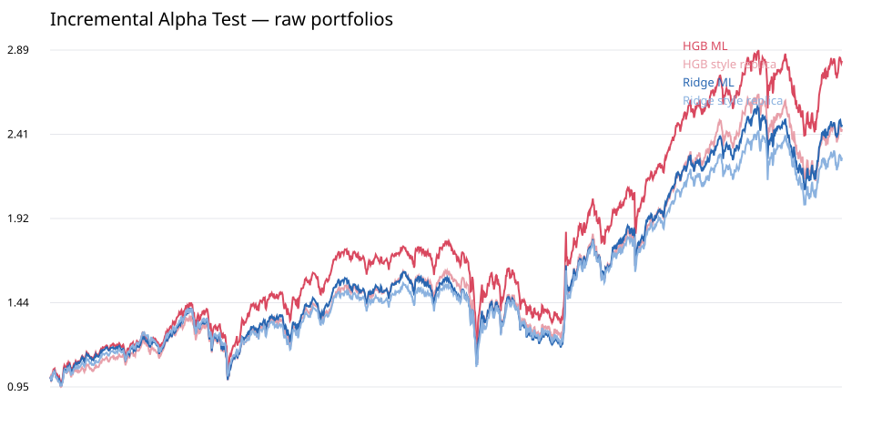

# Incremental Alpha Test：机器学习相对风格复制基准

## 识别设计

- 每个 ML 目标组合在同一信号日构造一个行业内特征匹配的同业复制组合；匹配只使用 PIT 的规模、Beta、波动、流动性、价值和动量暴露。
- 新鲜复制组合保持 ML 组合的行业权重和单票权重分布，并优先排除 ML 原持仓；随后施加与模型一致的 30% 周单边目标换手上限。
- 两边使用同一历史区间、下一交易日收盘股数订单、停牌/涨跌停逐日重试和 20bp 线性成本。
- 区间来自共同日历上的配对 20 日 circular block bootstrap；等波动收益差是事后诊断，不是可投资杠杆政策。

## 结论先行

- 四条 ML 管线中，1/4 条增量收益的单项 95% 区间排除零；对四条策略分别按指标执行 BH-FDR 5% 后为 0/4。
- 因此，单项显著只能视为局部证据；只有 `survives_bh_fdr_5pct=true` 才作为跨策略检验族内的稳健增量证据。
- 风险与交易效率同样同时披露单项区间和按指标跨四策略的 BH-FDR 结果。

## 可成交绩效（2021–2026 historical OOS）

| model                | alpha_pipeline            |   annualized_return_model |   annualized_return_style |   sharpe_zero_rate_model |   sharpe_zero_rate_style |   maximum_drawdown_model |   maximum_drawdown_style |   mean_turnover_model |   mean_turnover_style | incremental_alpha_significant_positive   | incremental_alpha_survives_bh_fdr_5pct   | multiplicity_controlled_risk_or_efficiency_value_detected   |
|:---------------------|:--------------------------|--------------------------:|--------------------------:|-------------------------:|-------------------------:|-------------------------:|-------------------------:|----------------------:|----------------------:|:-----------------------------------------|:-----------------------------------------|:------------------------------------------------------------|
| hgb_shallow15_locked | industry_size_neutralized |                  0.202598 |                  0.159625 |                 0.952482 |                 0.787283 |                -0.315308 |                -0.314091 |              0.063716 |              0.063778 | True                                     | False                                    | False                                                       |
| hgb_shallow15_locked | raw                       |                  0.208117 |                  0.175770 |                 0.937165 |                 0.837849 |                -0.333249 |                -0.330039 |              0.063826 |              0.063692 | False                                    | False                                    | False                                                       |
| ridge_locked         | industry_size_neutralized |                  0.158653 |                  0.134465 |                 0.790291 |                 0.687751 |                -0.317149 |                -0.315784 |              0.063539 |              0.063520 | False                                    | False                                    | False                                                       |
| ridge_locked         | raw                       |                  0.177959 |                  0.160881 |                 0.855759 |                 0.793654 |                -0.329912 |                -0.312305 |              0.063199 |              0.064053 | False                                    | False                                    | True                                                        |

## 配对增量检验（正值均代表 ML 更优）

| model                | alpha_pipeline            | strategy                                    | metric                                                      |   observations |   point_estimate |   ci_2_5pct |   ci_97_5pct |   probability_improvement_nonpositive |   bh_fdr_adjusted_probability | survives_bh_fdr_5pct   |
|:---------------------|:--------------------------|:--------------------------------------------|:------------------------------------------------------------|---------------:|-----------------:|------------:|-------------:|--------------------------------------:|------------------------------:|:-----------------------|
| hgb_shallow15_locked | industry_size_neutralized | industry_size_neutralized__risk_constrained | incremental_net_return_annualized_arithmetic                |           1387 |         0.036468 |    0.002444 |     0.071647 |                              0.018991 |                      0.075962 | False                  |
| hgb_shallow15_locked | industry_size_neutralized | industry_size_neutralized__risk_constrained | volatility_matched_incremental_return_annualized_arithmetic |           1387 |         0.036194 |    0.002681 |     0.071138 |                              0.017491 |                      0.069965 | False                  |
| hgb_shallow15_locked | industry_size_neutralized | industry_size_neutralized__risk_constrained | sharpe_improvement                                          |           1387 |         0.165200 |    0.011229 |     0.327766 |                              0.017491 |                      0.069965 | False                  |
| hgb_shallow15_locked | industry_size_neutralized | industry_size_neutralized__risk_constrained | maximum_drawdown_improvement                                |           1387 |        -0.001217 |   -0.023190 |     0.077232 |                              0.246877 |                      0.453107 | False                  |
| hgb_shallow15_locked | industry_size_neutralized | industry_size_neutralized__risk_constrained | turnover_improvement                                        |           1387 |         0.000062 |   -0.000065 |     0.000175 |                              0.157421 |                      0.314843 | False                  |
| hgb_shallow15_locked | industry_size_neutralized | industry_size_neutralized__risk_constrained | return_per_turnover_improvement                             |           1387 |         0.002282 |    0.000157 |     0.004463 |                              0.018491 |                      0.073963 | False                  |
| hgb_shallow15_locked | raw                       | raw__risk_constrained                       | incremental_net_return_annualized_arithmetic                |           1387 |         0.028702 |   -0.006198 |     0.065532 |                              0.054473 |                      0.108946 | False                  |
| hgb_shallow15_locked | raw                       | raw__risk_constrained                       | volatility_matched_incremental_return_annualized_arithmetic |           1387 |         0.022863 |   -0.011244 |     0.058786 |                              0.098951 |                      0.179244 | False                  |
| hgb_shallow15_locked | raw                       | raw__risk_constrained                       | sharpe_improvement                                          |           1387 |         0.099316 |   -0.050997 |     0.244116 |                              0.098951 |                      0.179244 | False                  |
| hgb_shallow15_locked | raw                       | raw__risk_constrained                       | maximum_drawdown_improvement                                |           1387 |        -0.003210 |   -0.029626 |     0.055973 |                              0.339830 |                      0.453107 | False                  |
| hgb_shallow15_locked | raw                       | raw__risk_constrained                       | turnover_improvement                                        |           1387 |        -0.000134 |   -0.000270 |     0.000006 |                              0.967516 |                      0.967516 | False                  |
| hgb_shallow15_locked | raw                       | raw__risk_constrained                       | return_per_turnover_improvement                             |           1387 |         0.001760 |   -0.000407 |     0.004028 |                              0.055472 |                      0.110945 | False                  |
| ridge_locked         | industry_size_neutralized | industry_size_neutralized__risk_constrained | incremental_net_return_annualized_arithmetic                |           1387 |         0.020542 |   -0.019353 |     0.056890 |                              0.154423 |                      0.205897 | False                  |
| ridge_locked         | industry_size_neutralized | industry_size_neutralized__risk_constrained | volatility_matched_incremental_return_annualized_arithmetic |           1387 |         0.022151 |   -0.017097 |     0.058171 |                              0.134433 |                      0.179244 | False                  |
| ridge_locked         | industry_size_neutralized | industry_size_neutralized__risk_constrained | sharpe_improvement                                          |           1387 |         0.102540 |   -0.083768 |     0.261081 |                              0.134433 |                      0.179244 | False                  |
| ridge_locked         | industry_size_neutralized | industry_size_neutralized__risk_constrained | maximum_drawdown_improvement                                |           1387 |        -0.001366 |   -0.034275 |     0.066550 |                              0.270365 |                      0.453107 | False                  |
| ridge_locked         | industry_size_neutralized | industry_size_neutralized__risk_constrained | turnover_improvement                                        |           1387 |        -0.000019 |   -0.000142 |     0.000095 |                              0.634683 |                      0.846244 | False                  |
| ridge_locked         | industry_size_neutralized | industry_size_neutralized__risk_constrained | return_per_turnover_improvement                             |           1387 |         0.001280 |   -0.001187 |     0.003531 |                              0.154423 |                      0.174913 | False                  |
| ridge_locked         | raw                       | raw__risk_constrained                       | incremental_net_return_annualized_arithmetic                |           1387 |         0.014905 |   -0.020586 |     0.050567 |                              0.208396 |                      0.208396 | False                  |
| ridge_locked         | raw                       | raw__risk_constrained                       | volatility_matched_incremental_return_annualized_arithmetic |           1387 |         0.013649 |   -0.021061 |     0.048733 |                              0.222389 |                      0.222389 | False                  |
| ridge_locked         | raw                       | raw__risk_constrained                       | sharpe_improvement                                          |           1387 |         0.062106 |   -0.101481 |     0.215325 |                              0.222389 |                      0.222389 | False                  |
| ridge_locked         | raw                       | raw__risk_constrained                       | maximum_drawdown_improvement                                |           1387 |        -0.017607 |   -0.051898 |     0.045495 |                              0.478761 |                      0.478761 | False                  |
| ridge_locked         | raw                       | raw__risk_constrained                       | turnover_improvement                                        |           1387 |         0.000853 |    0.000733 |     0.000973 |                              0.000500 |                      0.001999 | True                   |
| ridge_locked         | raw                       | raw__risk_constrained                       | return_per_turnover_improvement                             |           1387 |         0.001081 |   -0.001162 |     0.003321 |                              0.174913 |                      0.174913 | False                  |

## 暴露匹配与交易约束审计

| model                | alpha_pipeline            | strategy                                    |   dates |   mean_industry_gap |   max_industry_gap |   mean_overlap_weight |   mean_target_turnover |   max_target_turnover |   held_peer_fallback_weight |   mean_abs_size_gap |   mean_abs_beta_gap |   mean_abs_volatility_gap |   mean_abs_liquidity_gap |   mean_abs_value_gap |   mean_abs_momentum_gap |
|:---------------------|:--------------------------|:--------------------------------------------|--------:|--------------------:|-------------------:|----------------------:|-----------------------:|----------------------:|----------------------------:|--------------------:|--------------------:|--------------------------:|-------------------------:|---------------------:|------------------------:|
| hgb_shallow15_locked | industry_size_neutralized | industry_size_neutralized__risk_constrained |     293 |            0.003696 |           0.012300 |              0.011539 |               0.302375 |              1.000000 |                    0.000000 |            0.030298 |            0.035070 |                  0.216595 |                 0.286973 |             0.116558 |                0.199928 |
| hgb_shallow15_locked | raw                       | raw__risk_constrained                       |     293 |            0.003870 |           0.012672 |              0.010331 |               0.302389 |              1.000000 |                    0.000169 |            0.033545 |            0.033615 |                  0.162085 |                 0.275041 |             0.100846 |                0.222697 |
| ridge_locked         | industry_size_neutralized | industry_size_neutralized__risk_constrained |     293 |            0.004609 |           0.016877 |              0.010848 |               0.302389 |              1.000000 |                    0.000000 |            0.045289 |            0.063950 |                  0.303270 |                 0.297071 |             0.208789 |                0.331375 |
| ridge_locked         | raw                       | raw__risk_constrained                       |     293 |            0.004497 |           0.013190 |              0.009527 |               0.302389 |              1.000000 |                    0.000214 |            0.024901 |            0.050547 |                  0.217572 |                 0.295728 |             0.100100 |                0.316339 |

> 该检验隔离的是在相近行业/风格暴露与相同执行口径下的股票选择增量。若收益差区间跨零，但回撤、Sharpe 或换手效率显著改善，仍可认定模型存在非纯 Alpha 的实施价值。
